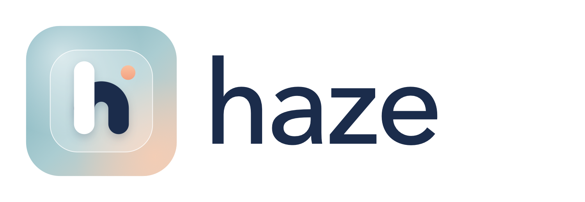

<p align="center">
  
</p>

<p align="center"><b>Your calendar, but calmer.</b><br>A native macOS calendar and to-do app with a soft, frosted-glass design.</p>

---

## Features

- **Week, Month, Agenda and Places views.** Week view has overlap-aware event cards, a live "now" line and a focus mode that widens a single day.
- **Two-way sync with Apple Calendar and Reminders.** Haze is built on EventKit, so any account on your Mac (iCloud, Google, Exchange) syncs automatically.
- **Drag to reschedule.** Events snap to 15-minute steps, with trackpad haptics and undo.
- **Natural-language entry.** Type "Coffee with Ana tomorrow 9am" and the date and time fill themselves in.
- **Locations that go somewhere.** Place search, map previews, and one-click hand-off to Apple Maps or Google Maps (including directions).
- **To-do list** backed by Reminders, with due dates, snoozing and quick add.
- **Up Next** card with a live countdown, Snooze, Mark as Completed and Join call for Zoom, Meet and Teams links.
- **Menu bar agenda** for today at a glance.
- **Living sky background** that drifts and shifts colour with the time of day.

## Install

Requires macOS 15 or later and the Xcode Command Line Tools.

```bash
git clone https://github.com/mazeencdev/haze.git
cd haze
./build.sh
open Haze.app
```

Drag `Haze.app` into Applications to keep it. On first launch Haze asks for access to Calendars and Reminders.

To add Google Calendar, add your Google account in **System Settings › Internet Accounts**. Its calendars show up in Haze right away.

## Keyboard shortcuts

| Shortcut | Action |
| --- | --- |
| ⌘N | New event |
| ⌘T | Jump to today |
| ⌘← / ⌘→ | Previous / next week or month |
| ⌘1 – ⌘5 | Switch views |
| ⌘E / ⌘⌫ | Edit / delete the selected event |
| ⌘R | Sync now |
| Double-click the grid | Create an event at that time |

## Demo mode

Run Haze on sample data, without touching your calendars:

```bash
HAZE_DEMO=1 open Haze.app
```

`swift Resources/record_demo.swift tour.mov` plays a scripted tour and records the window. It needs Screen Recording permission for the app you run it from. It also writes a cue timeline for syncing sound and captions.

## Project layout

```
Sources/Haze/        SwiftUI app (views, EventKit store, demo director)
Resources/           Info.plist, logo / icon renderer, demo recorder
Logo/                Logo and icon artwork
build.sh             Builds and signs Haze.app
```

## License

MIT © Mazeen
